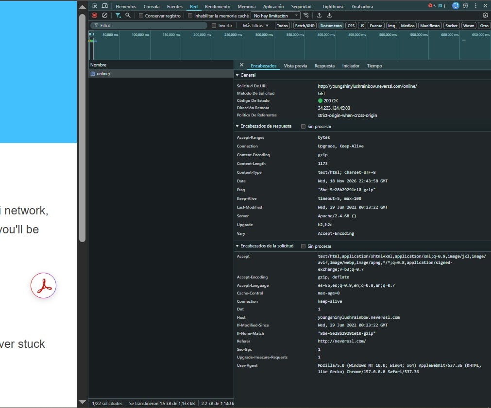
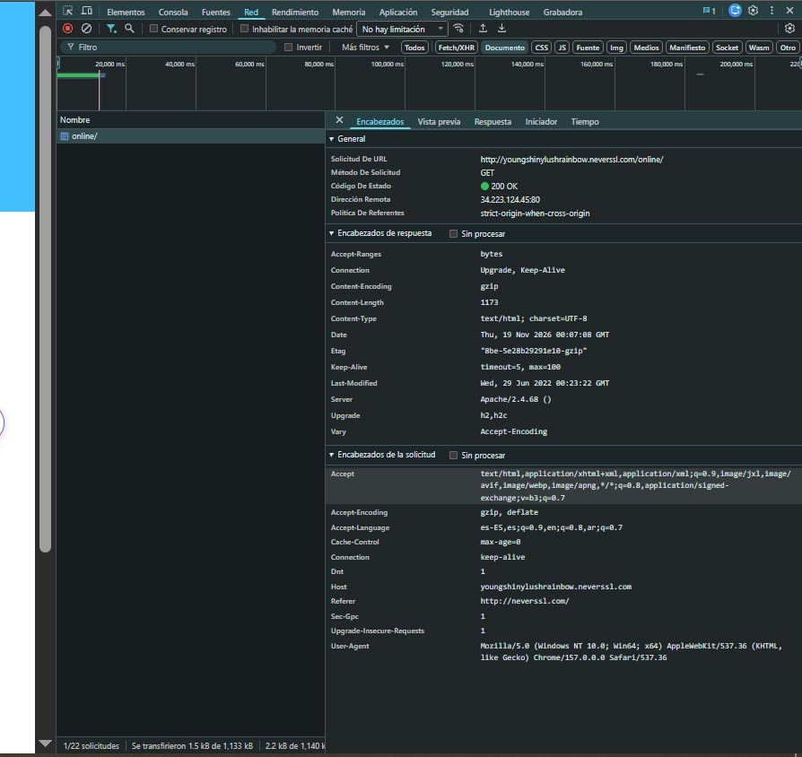
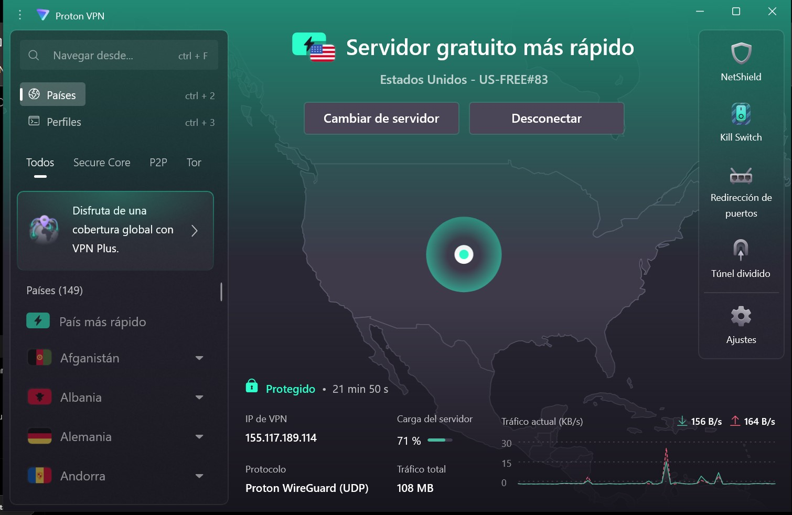

# PRÁCTICA WIFI SEGURA

## Informe de Auditoría: Seguridad en Redes Wi-Fi Públicas

**Curso:** Ciberseguridad  
**Comisión:** 90885  
**Estudiante:** Lucas Gustavo Decanio  
**Fecha de entrega:** 17 al 24 de noviembre de 2026

---

## 1. Introducción

Las redes Wi-Fi públicas, como las que podemos encontrar en cafeterías, aeropuertos, hoteles o centros comerciales, representan un riesgo potencial para la seguridad de nuestra información si no se utilizan las medidas de protección adecuadas.

Uno de los principales problemas aparece cuando accedemos a sitios web que utilizan el protocolo HTTP en lugar de HTTPS. HTTP transmite la información sin cifrado, lo que puede permitir que un atacante que consiga interceptar el tráfico de red observe datos intercambiados entre el usuario y el servidor.

Entre las amenazas más comunes se encuentran el *sniffing* o captura de paquetes, los ataques de intermediario (*Man-in-the-Middle* o MITM) y el robo de información de sesión.

El objetivo de esta práctica es analizar el tráfico generado al acceder a un sitio web que utiliza HTTP, identificar los posibles riesgos de seguridad y observar qué protección adicional puede aportar una VPN al conectarnos a una red pública.

---

## 2. Sitio analizado y evidencia observada

Para realizar la prueba se utilizó el sitio web:

- **Sitio analizado:** [http://neverssl.com](http://neverssl.com)
- **URL observada en la solicitud:** `http://youngshinylushrainbow.neverssl.com/online/`
- **Host:** `youngshinylushrainbow.neverssl.com`
- **Protocolo:** HTTP
- **Método de solicitud:** GET
- **Código de respuesta:** 200 OK
- **Dirección IP remota observada:** `34.223.124.45`
- **Puerto:** 80

### Procedimiento de observación

Se ingresó al sitio web y se abrieron las herramientas de desarrollador del navegador mediante la tecla F12.

Luego, dentro de la pestaña **Network (Red)**, se seleccionó la solicitud correspondiente al sitio para observar los datos de comunicación entre el navegador y el servidor.

En la solicitud se identificaron diferentes encabezados (*headers*) que permiten conocer información sobre la comunicación, entre ellos:

- **Host:** identifica el servidor al que se dirige la solicitud.
- **User-Agent:** proporciona información sobre el navegador y el sistema operativo utilizado.
- **Accept-Language:** indica los idiomas preferidos por el navegador.
- **Referer:** informa desde qué página se originó la navegación.

### Análisis de la evidencia

La solicitud observada utiliza HTTP, un protocolo que no cifra la comunicación mediante TLS.

Esto significa que, si un atacante consigue acceder al tráfico de red, podría observar información transmitida entre el navegador y el servidor.

Además, algunos encabezados permiten obtener información sobre el entorno del usuario, como el navegador, el sistema operativo y sus preferencias de idioma. Estos datos pueden contribuir a identificar características del dispositivo o del usuario, aunque no permiten por sí solos acceder al equipo.

### Evidencia

**Captura de la inspección de tráfico sin VPN:**

---

## 3. Riesgos asociados al uso de HTTP en redes Wi-Fi públicas

El uso de HTTP en una red Wi-Fi pública puede exponer la información transmitida si un atacante consigue interceptar el tráfico. Entre los principales riesgos se encuentran:

### 3.1. Sniffing o captura de paquetes

El *sniffing* consiste en capturar y analizar los paquetes que circulan por una red.

Mediante herramientas como Wireshark, un atacante que consiga acceder al tráfico de red podría observar información transmitida sin cifrado.

Por ejemplo, si un usuario envía credenciales, datos de formularios o información personal mediante HTTP, estos datos podrían quedar expuestos.

### 3.2. Ataques Man-in-the-Middle (MITM)

Un ataque MITM ocurre cuando un atacante consigue posicionarse entre el dispositivo del usuario y el servidor con el que se comunica.

En una comunicación HTTP, al no existir cifrado mediante TLS, el atacante podría llegar a observar o modificar la información transmitida.

Esto podría permitir la modificación de respuestas del servidor, la redirección hacia sitios fraudulentos o la inyección de contenido malicioso.

### 3.3. Secuestro de sesión (Session Hijacking)

El secuestro de sesión consiste en obtener y utilizar información que permite suplantar la sesión de un usuario.

Si una aplicación transmite cookies de sesión mediante HTTP y estas no cuentan con mecanismos de protección adecuados, un atacante que intercepte el tráfico podría obtenerlas y utilizarlas para intentar acceder a una sesión ajena.

Una de las medidas de protección es el atributo `Secure` en las cookies, que indica al navegador que solo debe enviarlas mediante conexiones HTTPS.

**Aclaración:** estos riesgos son posibilidades asociadas al uso de comunicaciones HTTP. La inspección realizada en esta práctica permitió identificar el uso de HTTP, pero no demuestra que se hayan producido ataques ni que el sitio haya transmitido cookies vulnerables.

---

## 4. Análisis comparativo: Modo Incógnito vs. VPN

Para comprender mejor las medidas de protección disponibles al navegar por redes públicas, es importante diferenciar el funcionamiento del modo incógnito del navegador y una conexión VPN.

### 4.1. Modo incógnito

El modo incógnito permite navegar sin guardar de forma habitual el historial de navegación, las cookies y otros datos de sesión una vez que se cierra la ventana privada.

Sin embargo, esta función no cifra el tráfico de red ni oculta la actividad del usuario frente al proveedor de Internet, el administrador de la red Wi-Fi o un atacante que consiga interceptar las comunicaciones.

Por lo tanto, si se accede a un sitio HTTP desde una ventana de incógnito, la información continúa transmitiéndose sin cifrado mediante TLS.

### 4.2. VPN (Red Privada Virtual)

Una VPN establece un túnel cifrado entre el dispositivo del usuario y el servidor VPN.

De esta manera, ayuda a proteger el tráfico frente a personas que puedan observar la red local, como podría ocurrir al conectarse a una Wi-Fi pública.

Además, los sitios web normalmente reciben la dirección IP de salida del servidor VPN en lugar de la dirección IP pública original del usuario.

Sin embargo, una VPN no convierte automáticamente una conexión HTTP en HTTPS. Si el sitio utiliza HTTP, la comunicación entre el servidor VPN y el sitio web continúa sin contar con el cifrado TLS propio de HTTPS.

Por este motivo, una VPN es una capa adicional de protección, pero no reemplaza la importancia de utilizar sitios web que implementen HTTPS.

### 4.3. Prueba práctica con Proton VPN

Se realizó una segunda prueba utilizando Proton VPN.

Primero se verificó que la VPN estuviera conectada y luego se volvió a ingresar al sitio `http://neverssl.com`, repitiendo la inspección desde la pestaña Network del navegador.

Al comparar ambas capturas, se observó que la solicitud continuaba utilizando HTTP y que los datos visibles de la solicitud al sitio eran esencialmente los mismos.

Esto es esperable: las herramientas de desarrollador muestran la solicitud realizada al sitio web, no el contenido del túnel cifrado entre el dispositivo y el servidor VPN.

Por lo tanto, que los datos de la solicitud HTTP sigan apareciendo en DevTools no significa que la VPN no esté funcionando. Significa que la VPN no modifica el protocolo utilizado por el sitio web.

**Evidencia de la inspección con VPN:**

**Evidencia de Proton VPN conectado:**

**Conclusión de la comparación:**

El modo incógnito protege principalmente la privacidad local de la navegación, mientras que una VPN cifra el tráfico entre el dispositivo y el servidor VPN.

Ambas herramientas cumplen funciones diferentes. Para una navegación más segura, es recomendable utilizar una VPN en redes públicas y acceder siempre que sea posible a sitios web que utilicen HTTPS.

---

## 5. Las 3 Reglas de Oro para navegar en redes Wi-Fi públicas

Para reducir los riesgos al conectarnos a redes Wi-Fi públicas, es importante aplicar las siguientes medidas de seguridad:

### 5.1. Verificar la red antes de conectarse

Comprobar siempre el nombre de la red Wi-Fi con el establecimiento antes de conectarse. Evitar redes desconocidas o sospechosas, ya que podrían tratarse de redes gemelas malignas (*Evil Twins*) creadas para engañar a los usuarios.

### 5.2. Utilizar una VPN confiable

Activar una VPN antes de navegar cuando se utiliza una red pública. Esto permite establecer un túnel cifrado entre el dispositivo y el servidor VPN, protegiendo el tráfico frente a posibles interceptaciones dentro de la red local.

### 5.3. Utilizar HTTPS y evitar operaciones sensibles en conexiones inseguras

Comprobar que los sitios web utilicen HTTPS antes de introducir contraseñas, datos personales o información bancaria. Evitar realizar operaciones sensibles si no se puede garantizar una conexión segura. Recordar que una VPN no reemplaza el cifrado HTTPS.

---

## 6. Conclusión final

Las redes Wi-Fi públicas ofrecen comodidad, pero también pueden representar riesgos para la privacidad y la seguridad de nuestros datos.

A través de esta práctica se pudo identificar el uso del protocolo HTTP, reconocer qué información puede observarse durante una solicitud web y comprender los riesgos asociados a una comunicación sin cifrado TLS.

También se pudo analizar cómo una VPN aporta una capa adicional de protección mediante un túnel cifrado, aunque no reemplaza la necesidad de utilizar conexiones HTTPS.

La seguridad al navegar depende de combinar herramientas tecnológicas con hábitos responsables de uso.
